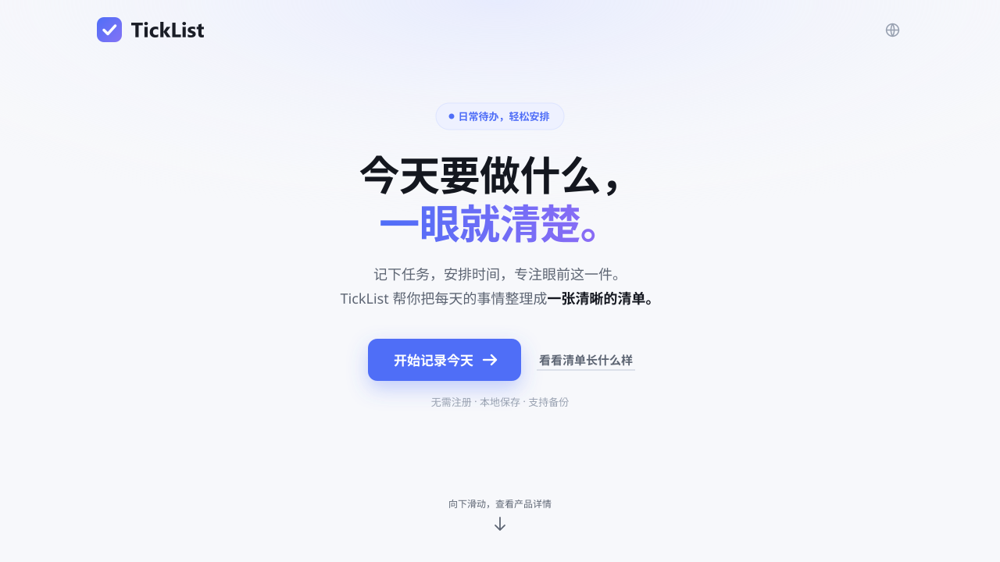
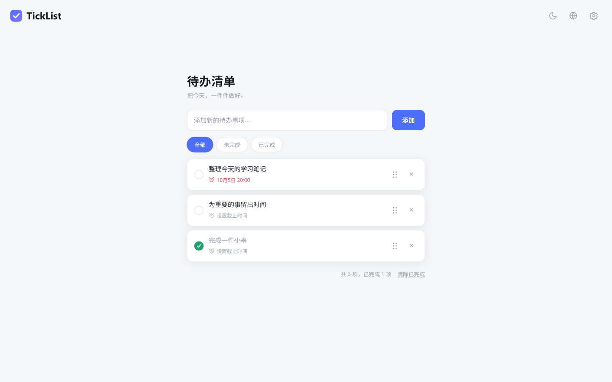

# TickList

今天要做什么，一眼就清楚。把今天，一件件做好。

TickList 是面向电脑端的轻量待办网页：无需注册，任务保存在当前浏览器。使用普通 HTML、CSS 和 JavaScript，没有框架、第三方运行依赖或构建前置步骤。

## 页面展示

### 产品介绍页（Landing）

介绍 TickList 的使用方式与价值，从“开始记录今天”进入清单。

[](docs/visuals/landing-zh.svg)

[查看介绍页 SVG 原图](docs/visuals/landing-zh.svg) · [页面源码](landing.html)

### 清单页（产品界面）

一行记录任务，安排截止时间，查看未完成事项，逐项完成。

按 1440 × 900 桌面实机比例展示：清单宽度 560 px，保留页面原有留白、字号与控件尺寸。

[](docs/visuals/app-zh.svg)

[查看清单页 SVG 原图](docs/visuals/app-zh.svg) · [页面源码](index.html)

展示图按现有页面样式绘制为原生 SVG，文字与图形均为矢量，放大不会产生截图像素模糊。图中只使用公开示例任务；这是静态界面展示，实际浏览器验收截图保留在 `docs/screenshots/`。

## 下载与宣传视频

应用与宣传附件已上传至[现有私有草稿](https://github.com/Aaron7510/TickList-Local-Todo/releases/tag/untagged-120f1e02c48e498c9327)，2026-10-21 已核对五份附件的大小及 SHA-256，均与本地一致。仓库仍为私有，正式 Release 尚未发布；以下链接需要仓库访问权限。

- [打开 35 秒宣传片 MP4](https://github.com/Aaron7510/TickList-Local-Todo/releases/download/untagged-120f1e02c48e498c9327/TickList-Promo-35s-1080p60.mp4) · [查看横版封面](https://github.com/Aaron7510/TickList-Local-Todo/releases/download/untagged-120f1e02c48e498c9327/TickList-Promo-Cover-1920x1080.jpg) · [媒体 SHA-256 校验文件](https://github.com/Aaron7510/TickList-Local-Todo/releases/download/untagged-120f1e02c48e498c9327/TickList-Promo-SHA256SUMS.txt)。
- [下载应用离线 ZIP](https://github.com/Aaron7510/TickList-Local-Todo/releases/download/untagged-120f1e02c48e498c9327/TickList-v0.1.0.zip) · [应用 ZIP 校验文件](https://github.com/Aaron7510/TickList-Local-Todo/releases/download/untagged-120f1e02c48e498c9327/TickList-v0.1.0.zip.sha256)。
- 文件规格、批准和来源见[视频定版登记](marketing/video/定版登记.md)。Landing 与清单页的原生 SVG 展示保持。

## 使用

打开 `landing.html` 查看产品介绍，点击“开始记录今天”进入清单；也可以直接打开 `index.html`。移动或分发时，请一起保留两个 HTML 和 `assets/`。

开发预览可安装 Node.js 24 LTS 后，在项目根目录运行：

```text
npm run serve
```

打开终端显示的本地地址，默认端口 4180。无需 `npm install`。Node 只用于检查、预览和打包，网页使用本身不依赖 Node。

## 功能

- 一行添加任务；全部、未完成、已完成筛选。
- 独立鼠标拖动手柄、截止时间弹窗和自动逾期状态。
- 点击任务查看详情，编辑名称和说明；创建时间放在详情内。
- 删除或清除已完成后，可在 10 秒内撤销。
- 设置按“数据”和“导出”分组：JSON 备份、恢复和 Markdown 导出。
- 深浅色模式，中英文切换；介绍页和清单页共用最近的语言选择。
- 保存异常和旧页面编辑冲突提示；内存中的未保存任务仍可备份。

当前版本只开发和维护电脑端。不提供账号、云同步、多设备同步或手机端适配承诺。

## 许可

代码采用 [MIT 许可](LICENSE)，Copyright (c) 2026 Soren。品牌图形及截图按 [品牌与素材说明](BRAND-LICENSE.md) 授权随项目展示和分发，不属于代码 MIT 许可范围，也不授予第三方字体分发权。

## 数据与备份

数据保存在当前浏览器的本地存储中，建议定期下载 JSON 备份。清除浏览器数据、更换浏览器或访问地址，可能使原清单无法访问；从本地文件迁到 HTTP 或 GitHub Pages 前，应先备份，再在新地址恢复。Markdown 是阅读文档，不能用来恢复完整数据。

兼容原任务键 `todo.list.v3`，支持 v1/v2 迁移。JSON 协议保持 `aaron-todo-backup`、版本 1；这是历史协议标识，页面产品名仍为 TickList。任务包含 id、text、description、done、deadline、createdAt，名称最多 200 字、说明最多 5000 字。

超过 5 MiB 的 JSON 备份会先提示耗时并询问是否继续，而不会仅因大小被拒绝。恢复还需确认覆盖；格式无效或浏览器无法保存时，当前清单不会被替换。

损坏数据会保留原键并尝试写入 recovery 副本；副本保留失败时禁止覆盖。副本尚无用户恢复入口。多页写入通过“保存前检查上次读取值”防止旧数据覆盖，出现冲突时先备份本页再刷新；尚无自动合并或跨页原子锁，建议一个页面编辑。

## 维护与发布

在项目根目录运行：

```text
npm run check
npm run package
```

检查包含 JavaScript 语法、资源路径及大小写、页面标签引用、四组隔离自动测试。测试不访问真实清单。发布命令只将两个页面和运行资产复制到 `dist/`，附带文件摘要清单；生成目录与本地归档不进入源码仓库。

| 目录 | 职责 |
| --- | --- |
| `index.html` / `landing.html` | 清单 / 产品介绍 |
| `assets/` | 页面脚本、样式及正式运行资产 |
| `tests/` | 存储、语言、任务流程及滚动进度检查 |
| `tools/` | 无第三方依赖的检查、预览和发布脚本 |
| `brand/` | 品牌规范、矢量生成源与字体比较 |
| `docs/` | 审查、优化日志、计划及公开示例截图 |
| `marketing/video/` | 宣传视频策划与定版登记 |
| `archive/` | 本地历史归档，默认忽略上传 |

脚本职责：`storage.js` 管数据校验与保存，`drag.js` 管拖动，`app.js` 协调任务交互，`theme.js` 管主题，`language.js/css` 管共用语言入口，`app-i18n.js` 和 `landing-i18n.js` 管翻译，`landing.js` 管滚动渐显。仍采用普通脚本顺序加载，支持本地文件打开。

2026-10-21 发布资料复核：产品运行代码及应用 ZIP 仍对应 v0.1.0 基准 `9896044`。文档和视频工程整理已通过提交 `9d6cef1` 同步私有仓库，[该提交 CI](https://github.com/Aaron7510/TickList-Local-Todo/actions/runs/39557948638)和干净检出检查、打包均通过；五份草稿附件的服务器摘要核对通过。Chrome/Edge 的浏览器证据来自 2026-10-08，本轮未重做人工浏览器验收或正式附件下载播放复验。仓库仍为私有，正式 Release 尚未发布；详细证据见审查记录。

- [当前代码审查](docs/maintenance/代码审查.md)
- [目录整理记录](docs/maintenance/目录归档检查.md)
- [每日优化日志](docs/maintenance/优化日志.md)
- [GitHub 上传计划](docs/release/GitHub上传计划.md)
- [本次上传范围与白名单生成](docs/release/上传范围说明.md)
- [2026-10-06 今日计划](docs/plan/2026-10-06.md)
- [品牌规范](brand/README.md) · [品牌预览](brand/preview.html)
- [宣传视频定版登记与公开文件](marketing/video/定版登记.md)
- [最小视频工程](marketing/video/production/README.md) · [废案清理报告](docs/maintenance/视频废案清理报告.md)
- [宣传视频策划](marketing/video/品牌IP与宣传视频策划.md)

正式字标为 Segoe UI Bold，勾号作为品牌核心，开发者为 Soren。代码和品牌许可范围见上方许可说明。
